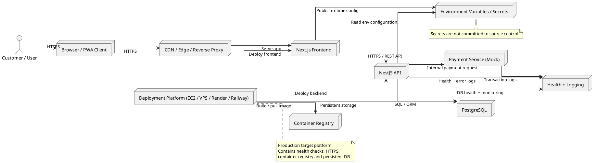

# Kiến trúc hệ thống BrewLite

## 1. Phương pháp và quyết định kiến trúc

BrewLite được thiết kế theo hướng kiến trúc phân lớp (layered architecture) kết hợp với mô hình module/domain ở phía backend. Đây là lựa chọn phù hợp cho một ứng dụng thương mại điện tử có phạm vi vừa, nơi cần giữ sự rõ ràng về trách nhiệm, dễ triển khai và dễ kiểm thử mà không cần bắt đầu với microservices ngay từ đầu.

### 1.1 Frontend – Next.js / PWA

Frontend chạy trên Next.js và TypeScript. Vai trò chính của frontend là:

- hiển thị menu sản phẩm;
- cho phép người dùng chọn món và quản lý giỏ hàng;
- thực hiện quy trình đặt hàng và thanh toán;
- hiển thị trạng thái đơn hàng và lịch sử đặt hàng;
- có khả năng mở rộng lên PWA để mang lại trải nghiệm gần giống mobile app.

### 1.2 Backend – NestJS theo module/domain

Backend chạy trên NestJS, tổ chức theo module/domain để chia logic theo nghiệp vụ rõ ràng. Một số module chính có thể bao gồm:

- auth / login
- products / menu
- product detail
- cart
- orders
- order history
- payments
- common / configuration

Cách tổ chức này giúp:

- tách rõ logic theo chức năng kinh doanh;
- giảm phụ thuộc chéo giữa các module;
- dễ bảo trì và mở rộng tính năng mới;
- phù hợp với mô hình modular monolith.

### 1.3 Dữ liệu – PostgreSQL và migration

PostgreSQL được chọn làm hệ thống lưu trữ dữ liệu chính. Với dữ liệu đặt hàng, thanh toán và trạng thái đơn hàng, PostgreSQL phù hợp nhờ:

- hỗ trợ transaction;
- khả năng quản lý dữ liệu quan hệ tốt;
- dễ triển khai ở local và production;
- phù hợp để tích hợp migration và schema versioning.

Quy trình migration phải được quản lý rõ ràng theo version để đảm bảo schema và source code luôn đồng bộ.

### 1.4 Dịch vụ thanh toán mô phỏng

Đối với assignment, dịch vụ thanh toán không cần tích hợp cổng thanh toán thật. Thay vào đó, hệ thống sử dụng payment service mock / simulation với các bước:

- nhận đơn hàng và thông tin thanh toán;
- validate dữ liệu đầu vào;
- trả về trạng thái success / failed / pending;
- lưu log giao dịch và trả kết quả cho order service.

Cách này giúp luồng nghiệp vụ rõ ràng, dễ test và dễ thay thế khi cần tích hợp cổng thanh toán thực tế sau này.

### 1.5 Logging, health check và quản lý cấu hình

Để hỗ trợ vận hành, hệ thống cần có:

- logging: ghi log request, lỗi, transaction và trạng thái xử lý;
- health check endpoint: theo dõi trạng thái API;
- quản lý biến môi trường: `.env`, secret, config tập trung;
- observability cơ bản để đo hiệu suất và trạng thái hệ thống.

Health check và logging phải đảm bảo không lưu secret, private key hoặc credential nhạy cảm vào logs hoặc source code.

## 2. Lý do chọn kiến trúc

### 2.1 Ưu điểm

- Next.js phù hợp với UI hiện đại và tương tác người dùng tốt.
- NestJS theo module/domain giúp tổ chức code rõ ràng và dễ mở rộng.
- PostgreSQL phù hợp cho dữ liệu transactional như đơn hàng và thanh toán.
- Modular monolith dễ triển khai, test và debug hơn so với microservices ngay từ đầu.
- Kiến trúc này phù hợp với assignment và dễ chuyển đổi nếu cần mở rộng hệ thống về sau.

### 2.2 Hạn chế và trade-off

- Khi hệ thống lớn lên, monolith có thể cần chia ra service rõ hơn theo domain.
- Payment mock giúp rút ngắn thời gian phát triển nhưng không phản ánh thực tế cổng thanh toán thật.
- Việc tách module rõ ràng đòi hỏi team tuân thủ naming và responsibility discipline.

### 2.3 Kết luận

Kiến trúc đề xuất của BrewLite là một modular monolith với frontend riêng, backend riêng, database riêng và các tầng rõ ràng. Đây là lựa chọn cân bằng giữa tính thực tiễn, dễ triển khai, dễ kiểm thử và khả năng mở rộng trong tương lai.

## 3. Deployment diagram – mục tiêu production

Sơ đồ dưới đây mô tả kiến trúc triển khai dự kiến của hệ thống trong môi trường production. Đây là deployment diagram mục tiêu, không phản ánh doanh nghiệp đã được provision hoặc deploy thật trên AWS trong assignment này.

## 4. Ranh giới giữa local, CI và production

### Local
- Frontend và backend chạy ở môi trường phát triển local.
- PostgreSQL chạy trong local container hoặc service cục bộ.
- Cấu hình dùng `.env.example` và biến môi trường mẫu.

### CI
- Pipeline chạy install, lint, unit test và build.
- Không triển khai production từ CI.
- CI chủ yếu kiểm tra chất lượng và tính khả dụng trước khi merge.

### Production
- Hệ thống được deploy trên nền tảng đã chọn.
- Dùng HTTPS, reverse proxy, registry, persistent storage và health check.
- Secret và môi trường production phải được lưu ngoài source control.

## 5. Kết luận

BrewLite nên được triển khai theo kiến trúc modular monolith phân lớp, với frontend Next.js, backend NestJS theo module/domain, dữ liệu PostgreSQL với migration rõ ràng, và dịch vụ thanh toán mô phỏng ở tầng nghiệp vụ. Đây là lựa chọn phù hợp với phạm vi dự án, dễ triển khai, dễ kiểm thử và đủ mạnh để phát triển thêm trong tương lai.

Deployment diagram phía trên phản ánh kiến trúc triển khai mục tiêu của hệ thống, với các thành phần chính, ranh giới bảo mật, connection và health check. Nó là bản mô tả thiết kế cho deployment, chứ không phải hiện trạng AWS đã được provision trong assignment này.
