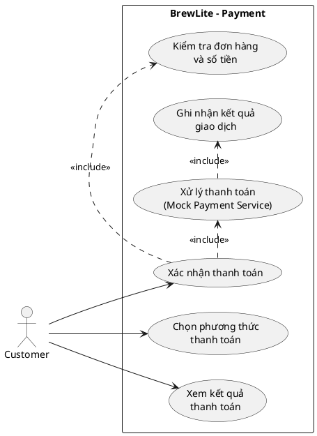

# Payment – Yêu cầu chức năng và phi chức năng (SRS rút gọn)

> Đây là phần SRS chuyên biệt cho Payment, dùng để nhóm tích hợp vào SRS cấp hệ thống. Các mã FR/NFR cần được kiểm tra để không trùng mã với tài liệu chung của nhóm.

## 1. Mô tả

Chức năng cho phép khách hàng thanh toán một đơn hàng đã tạo bằng phương thức Ví hoặc Thẻ mô phỏng. Backend xác thực yêu cầu, lấy số tiền từ đơn hàng, gọi Mock Payment Service, lưu kết quả và trả phản hồi cho frontend.

## 2. Yêu cầu chức năng

| Mã | Yêu cầu | Ưu tiên | Tiêu chí chấp nhận có thể kiểm chứng |
|---|---|---|---|
| PAY-FR-01 | Hệ thống phải cho phép khách hàng chọn phương thức `WALLET` hoặc `CARD`. | Must | Gửi request với `WALLET` hoặc `CARD` được chấp nhận; phương thức không nằm trong danh sách bị từ chối validation. |
| PAY-FR-02 | Hệ thống phải tiếp nhận yêu cầu thanh toán cho một đơn hàng đã tồn tại và thuộc quyền truy cập của khách hàng. | Must | Với orderId hợp lệ và đúng chủ sở hữu, request được xử lý; orderId không tồn tại hoặc không thuộc quyền truy cập bị từ chối. |
| PAY-FR-03 | Backend phải xác định số tiền thanh toán từ dữ liệu đơn hàng đã lưu. | Must | Thay đổi hoặc giả mạo amount ở phía client không làm thay đổi số tiền backend xử lý. |
| PAY-FR-04 | Hệ thống phải gửi yêu cầu hợp lệ đến Mock Payment Service. | Must | Khi request hợp lệ, mock service được gọi với thông tin đơn hàng, số tiền và phương thức cần thiết. |
| PAY-FR-05 | Hệ thống phải lưu kết quả thanh toán thành công với trạng thái `SUCCESS`. | Must | Khi mock service trả kết quả thành công, bản ghi Payment được lưu/cập nhật thành công và API trả kết quả thành công. |
| PAY-FR-06 | Hệ thống phải lưu kết quả thanh toán thất bại với trạng thái `FAILED`. | Must | Khi mock service trả kết quả thất bại, Payment ghi nhận `FAILED`; frontend nhận được phản hồi thất bại và không hiển thị đã thanh toán thành công. |
| PAY-FR-07 | Hệ thống phải hỗ trợ `idempotencyKey` để nhận diện yêu cầu thanh toán được gửi lại. | Must | Gửi lại cùng key cho cùng yêu cầu không tạo thêm một giao dịch thanh toán logic; hệ thống trả lại kết quả đã được ghi nhận hoặc phản hồi tương đương theo thiết kế API. |
| PAY-FR-08 | Hệ thống phải trả kết quả xử lý để frontend hiển thị cho khách hàng. | Must | Response thể hiện được kết quả thành công/thất bại và thông tin cần thiết như mã giao dịch hoặc mã đơn nếu có trong API. |
| PAY-FR-09 | Hệ thống phải từ chối yêu cầu thiếu hoặc sai dữ liệu bắt buộc. | Must | Thiếu `orderId`, `method` hoặc `idempotencyKey`, hoặc method không hợp lệ, bị validation từ chối. |
| PAY-FR-10 | Hệ thống không được ghi nhận một đơn đã thanh toán thành công như một giao dịch thanh toán mới nếu khách gửi yêu cầu thanh toán lại. | Should | Khi order đã được thanh toán thành công, request mới không tạo thanh toán thành công lần hai; phản hồi theo quy tắc nghiệp vụ của nhóm. |

## 3. Yêu cầu phi chức năng

| Mã | Yêu cầu | Ưu tiên | Tiêu chí chấp nhận có thể kiểm chứng |
|---|---|---|---|
| PAY-NFR-01 | Bảo mật: API thanh toán phải yêu cầu xác thực và kiểm tra quyền truy cập đơn hàng. | Must | Request không có JWT hợp lệ bị từ chối; người dùng không thể thanh toán order của người khác. |
| PAY-NFR-02 | Toàn vẹn dữ liệu: số tiền và liên kết Payment–Order phải nhất quán với dữ liệu đơn hàng. | Must | Test API chứng minh amount xử lý lấy từ database; không lưu Payment cho order không hợp lệ. |
| PAY-NFR-03 | Tính nhất quán: trạng thái Payment và trạng thái Order phải tuân theo cùng một quy tắc nghiệp vụ. | Must | Integration test xác nhận kết quả Payment thành công/thất bại dẫn đến trạng thái Order theo quy định của nhóm; không có trạng thái mâu thuẫn. |
| PAY-NFR-04 | Khả năng kiểm thử: Mock Payment Service phải cho phép tái hiện cả kết quả thành công và thất bại. | Must | Có test cho cả hai nhánh SUCCESS và FAILED mà không cần giao dịch tiền thật. |
| PAY-NFR-05 | Khả năng phục hồi trước request lặp: xử lý idempotency phải an toàn khi client retry. | Must | Integration test gửi nhiều request cùng idempotencyKey và xác nhận chỉ có một kết quả giao dịch logic. |
| PAY-NFR-06 | Bảo vệ dữ liệu: hệ thống không lưu thông tin thẻ nhạy cảm trong MVP. | Must | Kiểm tra schema và payload/log không có số thẻ đầy đủ, CVV hoặc mật khẩu thanh toán. |

## 4. Use-case tổng quát trong phạm vi Payment

Sơ đồ dưới đây mô tả phần chức năng Payment. Nhóm cần tích hợp nó vào use-case diagram tổng quát toàn hệ thống theo yêu cầu Task 1.2.

## 5. Quy tắc nghiệp vụ và điểm cần thống nhất

1. Backend là nguồn xác định số tiền phải thanh toán.
2. Chỉ xử lý thanh toán cho đơn hàng tồn tại, hợp lệ và thuộc quyền truy cập của khách hàng.
3. `WALLET` và `CARD` là hai giá trị phương thức được hỗ trợ trong MVP.
4. `SUCCESS` và `FAILED` là kết quả nghiệp vụ mô phỏng. Nếu code đang dùng enum khác, phải dùng đúng enum thực tế khi tích hợp.
5. `idempotencyKey` phải được kiểm tra ở backend; chỉ thêm unique constraint/transaction theo cách phù hợp với schema và database hiện có.
6. Tên trạng thái Order sau thanh toán phải lấy theo quy ước module Order của nhóm, không tự tạo enum mới trong tài liệu Payment.

## 6. Traceability sơ bộ

| Yêu cầu | Use-case | API / thành phần dự kiến | Kiểm thử dự kiến |
|---|---|---|---|
| PAY-FR-01 | UC-PAY-01 | `POST /payments` – method | PAY-UT-01 |
| PAY-FR-02 | UC-PAY-01 | Auth guard + Payment service + Order repository | PAY-IT-01 |
| PAY-FR-03 | UC-PAY-01 | Payment service đọc Order từ database | PAY-IT-02 |
| PAY-FR-04 | UC-PAY-01 | Mock Payment Service | PAY-UT-02 |
| PAY-FR-05 | UC-PAY-01 | Payment repository | PAY-IT-03 |
| PAY-FR-06 | UC-PAY-01 | Payment repository + API response | PAY-IT-04 |
| PAY-FR-07 | UC-PAY-01 | `idempotencyKey` + database | PAY-IT-05 |
| PAY-NFR-01 | UC-PAY-01 | JWT guard + ownership check | PAY-IT-06 |
| PAY-NFR-06 | UC-PAY-01 | DTO/schema/logging | PAY-UT-03 |
