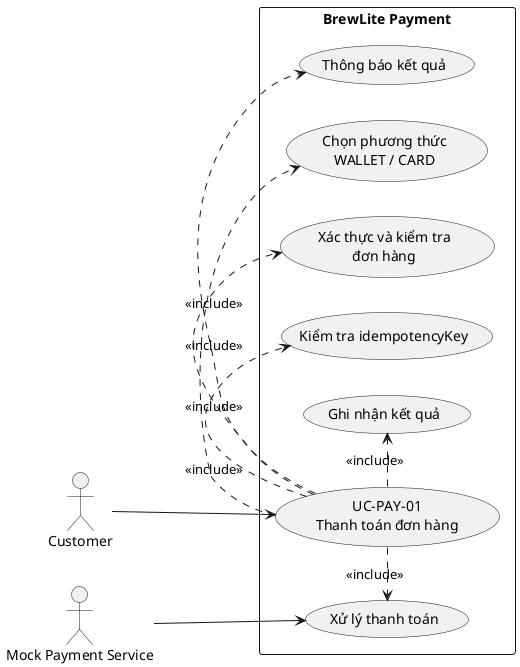

# UC-PAY-01 – Thanh toán đơn hàng

## 1. Thông tin chung

| Thuộc tính | Mô tả |
|---|---|
| Mã use-case | UC-PAY-01 |
| Tên | Thanh toán đơn hàng |
| Phạm vi | BrewLite – Payment |
| Actor chính | Customer |
| Actor / hệ thống phụ | Mock Payment Service |
| Mục tiêu | Khách hàng thanh toán đơn hàng bằng Ví hoặc Thẻ mô phỏng và nhận kết quả giao dịch |
| Trigger | Khách hàng chọn phương thức thanh toán và nhấn xác nhận thanh toán |
| Mức ưu tiên | Must |

## 2. Tiền điều kiện

1. Khách hàng đã đăng nhập.
2. Đơn hàng đã được tạo và tồn tại trong hệ thống.
3. Đơn hàng thuộc quyền truy cập của khách hàng.
4. Đơn hàng có số tiền hợp lệ và chưa được thanh toán thành công.
5. Backend và Mock Payment Service sẵn sàng xử lý yêu cầu.

## 3. Hậu điều kiện

### Thành công

- Kết quả Payment được lưu với trạng thái `SUCCESS`.
- Đơn hàng được cập nhật theo trạng thái thanh toán thành công đã thống nhất trong module Order.
- Frontend nhận kết quả và hiển thị thông báo thành công.

### Thất bại

- Kết quả Payment được ghi nhận `FAILED` nếu Mock Payment Service trả về thất bại và hệ thống lưu được kết quả.
- Đơn hàng không được đánh dấu đã thanh toán thành công.
- Frontend hiển thị thông báo thất bại và cho phép người dùng thực hiện bước tiếp theo theo quy tắc nghiệp vụ.

## 4. Luồng chính

| Bước | Actor / thành phần | Mô tả |
|---|---|---|
| 1 | Customer | Chọn Ví (`WALLET`) hoặc Thẻ (`CARD`). |
| 2 | Customer | Nhấn xác nhận thanh toán. |
| 3 | Next.js UI | Gửi yêu cầu thanh toán đến backend, gồm `orderId`, `method` và `idempotencyKey`. |
| 4 | NestJS API | Xác thực JWT, kiểm tra dữ liệu đầu vào và quyền truy cập đơn hàng. |
| 5 | NestJS API | Đọc đơn hàng từ database và xác định số tiền cần thanh toán. |
| 6 | NestJS API | Kiểm tra `idempotencyKey` để xác định request đã được xử lý hay chưa. |
| 7 | NestJS API | Gửi yêu cầu hợp lệ đến Mock Payment Service. |
| 8 | Mock Payment Service | Mô phỏng và trả kết quả thanh toán thành công. |
| 9 | NestJS API | Lưu kết quả Payment là `SUCCESS` và cập nhật trạng thái Order theo quy tắc của hệ thống. |
| 10 | NestJS API | Trả response kết quả thanh toán cho frontend. |
| 11 | Next.js UI | Hiển thị thông báo thanh toán thành công và thông tin đơn hàng cần thiết. |

## 5. Luồng thay thế

### A1 – Khách hàng chọn phương thức Ví

- Tại bước 1, khách hàng chọn `WALLET`.
- Hệ thống tiếp tục từ bước 2 của luồng chính.

### A2 – Khách hàng chọn phương thức Thẻ

- Tại bước 1, khách hàng chọn `CARD`.
- Hệ thống tiếp tục từ bước 2 của luồng chính.
- MVP chỉ mô phỏng phương thức thẻ, không thu thập hoặc lưu số thẻ/CVV thật.

### A3 – Mock Payment Service trả về thất bại

- Tại bước 8, Mock Payment Service trả kết quả thất bại.
- Backend ghi nhận Payment là `FAILED` nếu có thể lưu kết quả.
- Backend không đánh dấu Order là đã thanh toán thành công.
- Backend trả response thất bại.
- Frontend hiển thị thông báo thanh toán thất bại.

### A4 – Client gửi lại request với cùng `idempotencyKey`

- Tại bước 6, backend phát hiện key đã được xử lý.
- Backend không tạo thêm giao dịch logic cho cùng yêu cầu.
- Backend trả lại kết quả đã lưu hoặc response tương đương theo thiết kế API.
- Không gọi Mock Payment Service lần nữa nếu kết quả trước đó đã được xác định và lưu thành công.

## 6. Luồng ngoại lệ

### E1 – JWT không hợp lệ hoặc hết hạn

- Tại bước 4, backend không xác thực được JWT.
- Backend từ chối request.
- Frontend yêu cầu khách hàng đăng nhập lại.

### E2 – Đơn hàng không tồn tại hoặc không thuộc khách hàng

- Tại bước 4 hoặc 5, backend không tìm thấy đơn hàng hợp lệ hoặc khách hàng không có quyền truy cập.
- Backend từ chối request.
- Không gọi Mock Payment Service và không tạo Payment thành công.

### E3 – Dữ liệu đầu vào không hợp lệ

- Tại bước 4, thiếu `orderId`, `method`, `idempotencyKey` hoặc method không thuộc `WALLET`/`CARD`.
- Backend trả lỗi validation.
- Frontend hiển thị thông báo phù hợp.

### E4 – Mock Payment Service không phản hồi hoặc phát sinh lỗi kỹ thuật

- Tại bước 7 hoặc 8, service không trả được kết quả xác định.
- Backend không được tự kết luận giao dịch thành công.
- Backend trả lỗi phù hợp và giữ trạng thái dữ liệu theo quy tắc xử lý lỗi đã thống nhất.
- Việc retry phải sử dụng cùng `idempotencyKey` cho cùng một yêu cầu logic.

### E5 – Đơn hàng đã thanh toán thành công

- Backend phát hiện đơn hàng đã có kết quả thanh toán thành công.
- Backend không tạo thêm một giao dịch thanh toán thành công.
- Backend trả trạng thái hiện có hoặc lỗi nghiệp vụ theo thiết kế API.

## 7. Sơ đồ Use-case

## 8. Liên kết yêu cầu

| Yêu cầu | Nội dung được đáp ứng |
|---|---|
| PAY-FR-01 | Chọn phương thức Ví hoặc Thẻ |
| PAY-FR-02 | Kiểm tra đơn hàng và quyền truy cập |
| PAY-FR-03 | Backend xác định số tiền từ đơn hàng |
| PAY-FR-04 | Gọi Mock Payment Service |
| PAY-FR-05 | Ghi nhận kết quả thành công |
| PAY-FR-06 | Ghi nhận kết quả thất bại |
| PAY-FR-07 | Chống xử lý trùng bằng idempotencyKey |
| PAY-FR-08 | Trả kết quả cho frontend |
| PAY-FR-09 | Validate dữ liệu đầu vào |
| PAY-FR-10 | Không thanh toán thành công lần hai cho đơn đã thanh toán |

## 9. Tiêu chí chấp nhận

1. Khách hàng có thể chọn `WALLET` hoặc `CARD`.
2. Request thiếu trường bắt buộc hoặc có method không hợp lệ bị từ chối.
3. Request không có JWT hợp lệ hoặc không có quyền với order bị từ chối.
4. Backend sử dụng số tiền từ Order trong database.
5. Mock Payment Service trả thành công thì Payment được ghi nhận `SUCCESS`.
6. Mock Payment Service trả thất bại thì Payment được ghi nhận `FAILED` và Order không bị đánh dấu đã thanh toán thành công.
7. Gửi lại cùng `idempotencyKey` không tạo giao dịch logic trùng.
8. Lỗi từ Mock Payment Service không được hiển thị nhầm thành thanh toán thành công.

## 10. Ghi chú khi tích hợp với code

- Đối chiếu tên enum trạng thái Payment trong Prisma schema trước khi dùng các giá trị `SUCCESS`/`FAILED`.
- Đối chiếu tên trường trong DTO hiện tại; tài liệu này dự kiến `orderId`, `method`, `idempotencyKey`.
- Đối chiếu response thực tế của `POST /payments`.
- Xác nhận module Order có trạng thái nào tương ứng với thanh toán thành công/thất bại; không tự thêm tên trạng thái Order nếu chưa được nhóm thống nhất.
- Xác nhận cơ chế idempotency có lưu key và có ràng buộc phù hợp ở database hay chưa.
