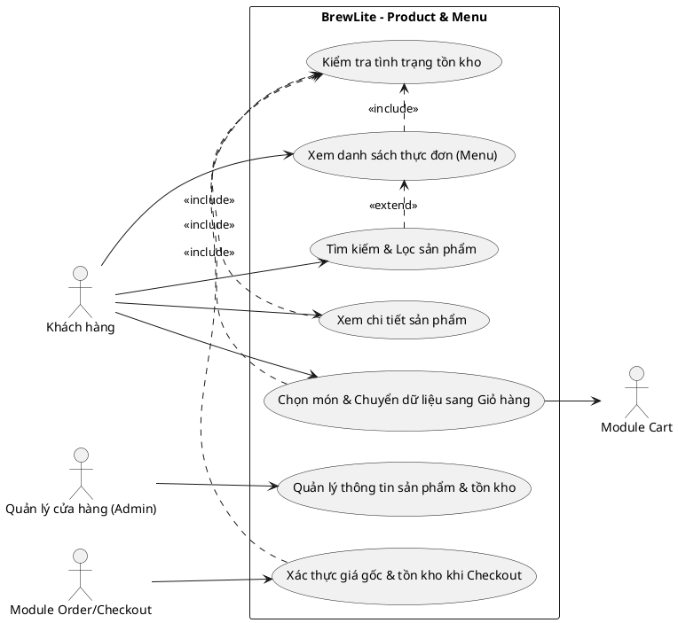

# Software Requirements Specification (SRS) – Module Product & Menu

## 1. Mục tiêu hệ thống

Module **Product & Menu** thuộc hệ thống **BrewLite** có nhiệm vụ cung cấp giao diện thực đơn trực tuyến và hệ thống API quản lý, truy xuất dữ liệu sản phẩm/đồ uống. Phân hệ giúp khách hàng dễ dàng xem danh sách sản phẩm, tìm kiếm và lọc món theo nhu cầu, xem thông tin chi tiết từng món (mô tả, hình ảnh, đơn giá, tồn kho) và chuyển dữ liệu sản phẩm chính xác sang giỏ hàng (**Cart**) cũng như quy trình đặt đơn (**Order/Checkout**).

## 2. Yêu cầu chức năng (Functional Requirements)

### FR-PROD-01: Xem danh sách sản phẩm (Menu)
Hệ thống cho phép khách hàng xem danh sách các sản phẩm đồ uống hiện có trong thực đơn của quán.

**Tiêu chí chấp nhận**
- Giao diện Menu hiển thị danh sách sản phẩm lấy từ API `GET /products`.
- Mỗi thẻ sản phẩm (Product Card) hiển thị tối thiểu: tên sản phẩm (`name`), hình ảnh (`imageUrl`), đơn giá (`price` định dạng VND) và trạng thái còn hàng/hết hàng dựa trên `stock`.
- Nếu danh sách sản phẩm trống, giao diện hiển thị thông báo "Hiện chưa có sản phẩm nào trong thực đơn" rõ ràng, không gây lỗi trang.

### FR-PROD-02: Tìm kiếm và lọc sản phẩm trên Menu
Hệ thống cho phép khách hàng tìm kiếm món theo từ khóa tên sản phẩm và lọc theo danh mục hoặc khoảng giá/trạng thái còn hàng.

**Tiêu chí chấp nhận**
- Khi người dùng nhập từ khóa tìm kiếm, hệ thống trả về danh sách các sản phẩm có tên hoặc mô tả khớp với từ khóa (không phân biệt chữ hoa/thường).
- Khi người dùng chọn một danh mục (ví dụ: Cà phê, Trà, Đá xay,...), danh sách chỉ hiển thị các món thuộc danh mục đó.
- Nếu không có sản phẩm nào khớp điều kiện tìm kiếm/lọc, hệ thống hiển thị thông báo "Không tìm thấy sản phẩm phù hợp" và nút xóa bộ lọc.

### FR-PROD-03: Xem chi tiết sản phẩm (Product Detail)
Hệ thống cho phép khách hàng chọn một món trên Menu để xem đầy đủ thông tin chi tiết của sản phẩm đó.

**Tiêu chí chấp nhận**
- Khi chọn một sản phẩm, hệ thống gọi `GET /products/:id` và hiển thị trang hoặc modal chi tiết sản phẩm.
- Thông tin hiển thị bao gồm: tên món, hình ảnh, mô tả chi tiết (`description`), đơn giá (`price`), số lượng tồn kho hiện có (`stock`) và các tùy chọn đi kèm (nếu có).
- Nếu `id` sản phẩm không tồn tại hoặc không hợp lệ, API trả về mã lỗi `HTTP 404 Not Found` và giao diện hiển thị thông báo sản phẩm không tồn tại kèm liên kết quay lại Menu.

### FR-PROD-04: Hiển thị trạng thái tồn kho và kiểm soát chọn món
Hệ thống hiển thị trạng thái khả dụng của sản phẩm dựa trên số lượng tồn kho (`stock`) và ngăn khách hàng chọn món đã hết hàng.

**Tiêu chí chấp nhận**
- Sản phẩm có `stock > 0` được hiển thị trạng thái "Còn hàng" (hoặc số lượng còn lại) và cho phép bấm nút "Thêm vào giỏ" với số lượng từ `1` đến `stock`.
- Sản phẩm có `stock = 0` hiển thị nhãn "Hết hàng" (Out of stock) và nút "Thêm vào giỏ" bị vô hiệu hóa (`disabled`).

### FR-PROD-05: Cung cấp API danh sách và chi tiết sản phẩm (Product API)
Backend NestJS cung cấp các RESTful API để Frontend và các module khác truy xuất dữ liệu sản phẩm.

**Tiêu chí chấp nhận**
- `GET /products`: Trả về `HTTP 200 OK` cùng mảng danh sách sản phẩm hợp lệ từ cơ sở dữ liệu PostgreSQL; hỗ trợ query params tìm kiếm/lọc cơ bản.
- `GET /products/:id`: Trả về `HTTP 200 OK` cùng đối tượng chi tiết sản phẩm nếu tìm thấy, hoặc `HTTP 404 Not Found` nếu không tìm thấy.

### FR-PROD-06: Quản lý dữ liệu sản phẩm (Tạo / Cập nhật sản phẩm & tồn kho)
Hệ thống cung cấp API cho phép quản trị viên/hệ thống tạo mới hoặc cập nhật thông tin sản phẩm (tên, mô tả, giá, hình ảnh, tồn kho).

**Tiêu chí chấp nhận**
- `POST /products` và `PATCH /products/:id` kiểm tra dữ liệu đầu vào (validation): `name` không được rỗng, `price` phải lớn hơn 0, `stock` phải là số nguyên không âm (`stock >= 0`).
- Nếu dữ liệu không hợp lệ, API từ chối và trả về `HTTP 400 Bad Request` kèm thông báo lỗi chi tiết.

### FR-PROD-07: Cung cấp dữ liệu chuẩn cho Giỏ hàng (Cart) và Đặt đơn (Order)
Module Product đóng vai trò nguồn dữ liệu chuẩn (Single Source of Truth) về thông tin món, đơn giá gốc và số lượng tồn kho cho toàn hệ thống.

**Tiêu chí chấp nhận**
- Khi khách bấm "Thêm vào giỏ", dữ liệu `productId`, `name`, `price`, `imageUrl`, `stock` được chuyển giao đầy đủ sang module Cart.
- Khi thực hiện Checkout/Order, module Order truy vấn trực tiếp bảng `Product` để lấy `price` gốc và kiểm tra `stock >= quantity` trước khi trừ kho.

## 3. Yêu cầu phi chức năng (Non-Functional Requirements)

| Mã | Yêu cầu | Ưu tiên | Tiêu chí chấp nhận có thể kiểm chứng |
| --- | --- | --- | --- |
| **NFR-PROD-01** | Hiệu năng phản hồi (Performance) | Must | API `GET /products` và `GET /products/:id` có thời gian phản hồi trung bình $\le 300\text{ ms}$ trong môi trường local/demo với dữ liệu thực đơn tiêu chuẩn. |
| **NFR-PROD-02** | Tính toàn vẹn và chính xác dữ liệu | Must | Đơn giá (`price`) luôn dương và số lượng tồn kho (`stock`) luôn là số nguyên không âm ($\ge 0$); dữ liệu hiển thị trên UI khớp 100% với dữ liệu từ API. |
| **NFR-PROD-03** | Khả năng chịu lỗi giao diện (Resilience) | Should | Khi ảnh sản phẩm (`imageUrl`) bị lỗi hoặc API trả về danh sách rỗng/lỗi mạng, giao diện hiển thị ảnh fallback hoặc thông báo lỗi thân thiện mà không bị crash trang. |
| **NFR-PROD-04** | Bảo mật (Security) | Must | Các tham số truy vấn (`search`, `category`, `id`) được kiểm tra hợp lệ và truyền qua Prisma ORM để chống SQL Injection; không lộ thông tin nhạy cảm trong response lỗi. |
| **NFR-PROD-05** | Khả năng bảo trì và mở rộng (Maintainability) | Should | Code Backend tách rõ `ProductsController`, `ProductsService` và DTO/Prisma model; dễ dàng bổ sung thuộc tính danh mục hoặc tùy chọn món mà không phá vỡ luồng cũ. |

## 4. Phân loại ưu tiên theo MoSCoW

### Must Have
- **FR-PROD-01:** Xem danh sách sản phẩm (Menu).
- **FR-PROD-03:** Xem chi tiết sản phẩm (Product Detail).
- **FR-PROD-04:** Hiển thị trạng thái tồn kho và chặn thêm món hết hàng.
- **FR-PROD-05:** Cung cấp API danh sách và chi tiết sản phẩm (`GET /products`, `GET /products/:id`).
- **FR-PROD-07:** Cung cấp dữ liệu sản phẩm chuẩn cho Cart và Order/Checkout.
- **NFR-PROD-01, NFR-PROD-02, NFR-PROD-04.**

### Should Have
- **FR-PROD-02:** Tìm kiếm và lọc sản phẩm theo từ khóa / danh mục.
- **FR-PROD-06:** API tạo mới và cập nhật thông tin sản phẩm / tồn kho kèm validation.
- **NFR-PROD-03, NFR-PROD-05.**

### Could Have
- Phân trang (Pagination) và sắp xếp danh sách sản phẩm theo giá tăng/giảm dần.
- Quản lý tùy chọn biến thể (Size S/M/L, mức đường/đá) cấu hình động theo từng món.

### Won't Have (trong MVP)
- Hệ thống quản lý công thức nguyên liệu thô (Inventory BOM) tự động quy đổi sang số cốc.
- Hệ thống đánh giá, bình luận sản phẩm (Review & Rating) hoặc gợi ý món bằng AI.

## 5. Quy tắc nghiệp vụ (Business Rules)

1. **BR-PROD-01 (Định danh và tính duy nhất):** Mỗi sản phẩm phải có `id` duy nhất và `name` không được để trống.
2. **BR-PROD-02 (Đơn giá hợp lệ):** Đơn giá sản phẩm (`price`) phải lớn hơn `0` (đơn vị VND). Mọi tính toán thành tiền chính thức ở bước đặt hàng phải sử dụng `Product.price` từ cơ sở dữ liệu.
3. **BR-PROD-03 (Kiểm soát tồn kho):** Tồn kho sản phẩm (`stock`) phải là số nguyên không âm (`stock >= 0`). Nếu `stock == 0`, sản phẩm được coi là "Hết hàng" và không thể thêm vào giỏ hàng hoặc tạo đơn.
4. **BR-PROD-04 (Quyền truy cập Menu):** Khách hàng (kể cả chưa đăng nhập) đều có quyền xem danh sách Menu và chi tiết sản phẩm.
5. **BR-PROD-05 (Ranh giới cập nhật tồn kho):** Module Product chỉ hiển thị và kiểm tra sơ bộ `stock`; việc trừ tồn kho chính thức khi mua hàng phải được thực hiện nguyên tử trong transaction của module Order/Checkout.

## 6. Sơ đồ Use-Case Module Product & Menu

## 7. Liên kết yêu cầu và kiểm thử

| Mã yêu cầu | Kịch bản kiểm thử gợi ý (Test Scenarios) |
| --- | --- |
| **FR-PROD-01** | Truy cập trang Menu khi có danh sách sản phẩm; truy cập trang Menu khi CSDL rỗng. |
| **FR-PROD-02** | Tìm kiếm với từ khóa khớp tên món (ví dụ: "Bạc xỉu"); tìm kiếm từ khóa không tồn tại; lọc theo danh mục. |
| **FR-PROD-03** | Xem chi tiết sản phẩm với `id` hợp lệ (`200 OK`); truy cập với `id` không tồn tại (`404 Not Found`). |
| **FR-PROD-04** | Kiểm tra hiển thị và nút bấm với sản phẩm còn hàng (`stock > 0`) và sản phẩm hết hàng (`stock = 0`). |
| **FR-PROD-05/06** | Gọi API tạo/cập nhật sản phẩm với dữ liệu hợp lệ; thử gửi `price <= 0` hoặc `stock < 0` và xác nhận hệ thống trả về `400 Bad Request`. |
| **FR-PROD-07** | Chọn món từ Menu/Product Detail thêm vào Cart; kiểm tra Order đọc lại `price` và `stock` từ bảng `Product`. |

