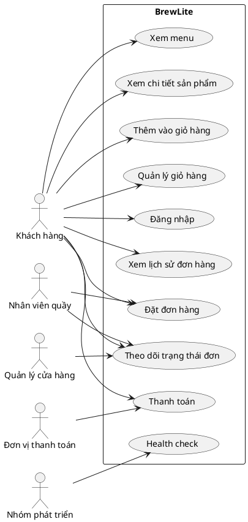

# Software Requirements Specification (SRS)

## 1. Mục tiêu hệ thống

BrewLite là hệ thống đặt hàng và thanh toán cho quán cà phê trực tuyến. Hệ thống cần hỗ trợ khách hàng xem menu, chọn món, kiểm tra giỏ hàng, xác nhận đơn, thanh toán và theo dõi trạng thái đơn hàng ở mức cơ bản. Mục tiêu là tạo trải nghiệm đặt hàng đơn giản, rõ ràng và đáng tin cậy.

## 2. Yêu cầu chức năng

### FR-01: Xem menu
Hệ thống cho phép khách hàng xem danh sách các món có sẵn trong menu.

**Tiêu chí chấp nhận**
- Người dùng có thể xem danh sách sản phẩm hiển thị trên giao diện.
- Mỗi món có ít nhất tên và giá hiển thị rõ ràng.

### FR-02: Xem chi tiết sản phẩm
Hệ thống cho phép người dùng xem thông tin chi tiết của một sản phẩm, bao gồm mô tả, hình ảnh, giá và tùy chọn nếu có.

**Tiêu chí chấp nhận**
- Khi chọn một món, hệ thống hiển thị trang hoặc modal chi tiết tương ứng.
- Thông tin hiển thị chính xác với dữ liệu sản phẩm.

### FR-03: Thêm vào giỏ hàng
Hệ thống cho phép người dùng thêm một hoặc nhiều món vào giỏ hàng.

**Tiêu chí chấp nhận**
- Một món được thêm thành công vào giỏ hàng.
- Số lượng món trong giỏ được cập nhật đúng.

### FR-04: Quản lý giỏ hàng
Hệ thống cho phép người dùng xem, cập nhật số lượng, xóa món và tính tổng tiền tạm thời.

**Tiêu chí chấp nhận**
- Giỏ hàng hiển thị danh sách món đã chọn.
- Tổng tiền được tính lại đúng sau khi thay đổi số lượng hoặc xóa món.

### FR-05: Xác thực người dùng
Hệ thống hỗ trợ xác thực cơ bản để người dùng có thể đăng nhập và truy cập chức năng đặt hàng.

**Tiêu chí chấp nhận**
- Người dùng hợp lệ có thể đăng nhập thành công.
- Người dùng không hợp lệ nhận được thông báo lỗi rõ ràng.

### FR-06: Đặt đơn hàng
Hệ thống cho phép khách hàng xác nhận đơn hàng từ giỏ hàng.

**Tiêu chí chấp nhận**
- Sau khi xác nhận, hệ thống tạo đơn hàng mới.
- Đơn hàng có trạng thái ban đầu rõ ràng, ví dụ chờ xử lý.

### FR-07: Thanh toán
Hệ thống cho phép khách hàng thực hiện thanh toán cho đơn hàng đã xác nhận.

**Tiêu chí chấp nhận**
- Thanh toán thành công sẽ cập nhật trạng thái giao dịch thành công.
- Thanh toán thất bại sẽ trả về thông báo lỗi tương ứng.

### FR-08: Xác nhận đơn hàng và thanh toán
Hệ thống báo cho người dùng và nhân viên biết đơn đã được đặt và thanh toán thành công.

**Tiêu chí chấp nhận**
- Người dùng nhận được xác nhận rõ ràng sau khi thanh toán.
- Thông tin đơn hàng được lưu và có thể truy vết.

### FR-09: Lịch sử đơn hàng
Hệ thống cho phép người dùng xem lịch sử đơn hàng đã đặt trước đó.

**Tiêu chí chấp nhận**
- Người dùng có thể xem các đơn hàng đã thực hiện.
- Mỗi đơn hiển thị ít nhất thời gian, tổng tiền và trạng thái.

### FR-10: Quản lý trạng thái đơn
Hệ thống lưu và hiển thị trạng thái đơn hàng trong quá trình xử lý.

**Tiêu chí chấp nhận**
- Đơn hàng có trạng thái hợp lệ như chờ xử lý, đang xử lý, hoàn tất hoặc hủy.
- Trạng thái được cập nhật rõ ràng sau từng bước xử lý.

### FR-11: Health check
Hệ thống cung cấp điểm kiểm tra sức khỏe API để giám sát trạng thái hệ thống.

**Tiêu chí chấp nhận**
- Endpoint health trả về trạng thái thành công khi backend hoạt động bình thường.

## 3. Yêu cầu phi chức năng

### NFR-01: Hiệu năng
Hệ thống phải phản hồi nhanh trong các thao tác chính như xem menu, thêm giỏ hàng và đặt đơn.

**Tiêu chí chấp nhận**
- Thời gian phản hồi của trang chính và API cốt lõi nằm trong ngưỡng chấp nhận được cho môi trường local và demo.

### NFR-02: Tính khả dụng
Hệ thống phải có thể chạy ổn định trong môi trường phát triển local và được chuẩn bị để triển khai trên môi trường production tương đối đơn giản.

**Tiêu chí chấp nhận**
- Backend và frontend có thể chạy cùng lúc mà không gây lỗi nặng ở luồng chính.

### NFR-03: Bảo mật
Hệ thống phải bảo vệ dữ liệu nhạy cảm và không lưu trữ secret, credential hoặc private key trong repository.

**Tiêu chí chấp nhận**
- Không có thông tin bí mật được commit vào code hoặc file cấu hình lưu trữ trên repo.

### NFR-04: Khả năng mở rộng
Hệ thống phải được xây dựng theo cấu trúc dễ mở rộng trong tương lai.

**Tiêu chí chấp nhận**
- Các module nghiệp vụ có thể được bổ sung mà không phá vỡ chức năng hiện có.

### NFR-05: Khả năng triển khai
Hệ thống phải hỗ trợ chạy local bằng Docker Compose và chuẩn bị cho triển khai trên nền tảng như EC2 / container host.

**Tiêu chí chấp nhận**
- Có thể chạy ứng dụng trên local bằng Docker hoặc docker-compose.
- Có cấu hình cụ thể cho frontend, backend và database.

## 4. Phân loại ưu tiên theo MoSCoW

### Must Have
- FR-01 Xem menu
- FR-02 Xem chi tiết sản phẩm
- FR-03 Thêm vào giỏ hàng
- FR-04 Quản lý giỏ hàng
- FR-05 Xác thực người dùng
- FR-06 Đặt đơn hàng
- FR-07 Thanh toán
- FR-08 Xác nhận đơn hàng và thanh toán
- FR-11 Health check

### Should Have
- FR-09 Lịch sử đơn hàng
- FR-10 Quản lý trạng thái đơn
- NFR-01 Hiệu năng
- NFR-02 Tính khả dụng

### Could Have
- Tùy chọn món bổ sung / variant
- Thông báo trạng thái chi tiết cho người dùng
- PWA / trải nghiệm mobile gần app

### Won't Have
- Tích hợp cổng thanh toán thật trong MVP
- Chạy đa cửa hàng phức tạp
- Dashboard doanh thu nâng cao
- Microservice hóa ngay từ đầu

## 5. Tiêu chí chấp nhận tổng quát

- Hệ thống cho phép người dùng thực hiện đầy đủ luồng đặt hàng từ xem menu tới thanh toán.
- Mỗi chức năng chính đều có thể được kiểm tra bằng test case rõ ràng.
- Hệ thống có tính khả dụng cơ bản và health check cho giám sát.
- Quy trình đặt hàng và thanh toán hoạt động ổn định trong điều kiện thành công và lỗi cơ bản.

## 6. Sơ đồ use-case tổng quát

## 7. Kết luận

SRS này tập trung vào các yêu cầu cốt lõi của BrewLite, với trọng tâm là luồng đặt món, giỏ hàng, thanh toán và quản lý trạng thái đơn. Mục tiêu là đảm bảo hệ thống có thể kiểm tra, triển khai và phát triển theo hướng rõ ràng trong giai đoạn MVP mà không bị rơi vào scope quá rộng.
